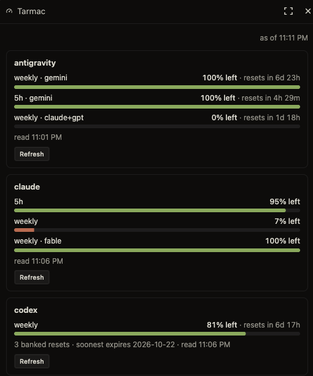

# Tarmac

<p><a href="assets/workstack-mark-full.png"></a></p>

Tarmac gives agents and people a shared view of LLM usage across harnesses. Agents can query its local API or CLI for the same observations people inspect in its dashboard: remaining usage windows, reset times, balances and login status.

Before deciding where to send work, an agent can check which account has capacity and when a limiting window resets. You can inspect that same usage view while working in a different harness. The service and its history persist independently of any one conversation or UI.

Use Tarmac alongside the tracking built into harnesses such as OpenChamber. A harness needs a way to call the local API or CLI; connecting it is part of your setup.

<p></p>

OpenChamber panel showing usage windows and banked Codex reset credits.

## Run from source

The core needs Python 3.11+ with SQLite support. It has no third-party Python runtime dependencies.

```sh
git clone https://github.com/batteryshark/tarmac.git
cd tarmac
python3 -m tarmac serve
```

Open <http://127.0.0.1:8767>. A new state directory starts without sources; [set up a provider](docs/reference.md#add-a-source) to collect readings. Enabled sources poll configured accounts and can consume capacity. Keep the service on loopback and its state private; read the [access model](docs/reference.md#credentials-and-local-access) before enabling sources.

With the service running, an agent can read cached observations from the source checkout:

```sh
python3 -m tarmac status --passive --json
```

This request doesn't trigger provider calls. The running poller continues independently, and an unknown or expired reading doesn't establish available capacity. Tarmac supplies observations; the caller decides what work to send.

## Further reading

- [Setup and reference](docs/reference.md): provider requirements, CLI/API, polling, credentials and background operation.
- [Development](docs/reference.md#development): source layout and test boundaries.
- [Optional OpenChamber extension](openchamber/README.md): source build and host requirements.

## License

Owned source and documentation are [MIT licensed](LICENSE). The comic artwork is AI-generated and offered under MIT to the extent applicable; see [RIGHTS.md](RIGHTS.md). Outside dependencies and provider software retain their own licenses and terms.
